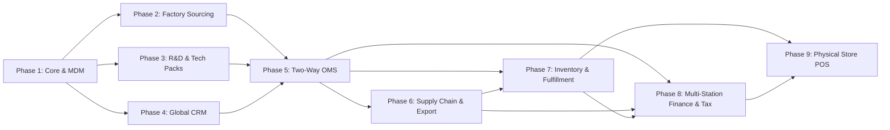

# ArielMC Enterprise ERP: Master Architecture & Implementation Blueprint

## 1. Corporate Profile & Strategic Architecture

**Ariel Marketing & Communications Limited (ArielMC)**
- **Headquarters**: Dhaka, Bangladesh (Operations, Sourcing, R&D Hub)
- **Overseas Legal Entities**:
  - **United Kingdom**: ArielMC UK Ltd (HMRC, VAT, EORI, UK 3PL, Amazon UK)
  - **United States**: ArielMC USA LLC (Federal EIN, State Nexus & Sales Tax, US FBA & 3PL)
  - **European Union**: ArielMC EU Entity (OSS/IOSS VAT, EU EORI, Continental 3PL)
  - **Australia**: ArielMC Australia Pty Ltd (ABN/ACN, GST, AU 3PL)
- **Websites & Digital Portals**:
  - `www.arielmc.com`: Global Corporate & B2B Buyer Portal
  - `www.arielmc.co.uk`: Regional UK B2B Trade & Brand Presence
  - `www.arielmc.shop`: D2C / B2C Flagship Store (Shopify Integration)

---

## 2. The 4 Product Sectors & Technical Data Requirements

Because ArielMC sources across 4 distinct manufacturing sectors in Bangladesh, the ERP Product Master must support sector-specific technical parameters:

| Product Sector | Core Manufacturing Parameters & Technical Attributes | International Compliance Standards |
| :--- | :--- | :--- |
| **Leather Goods** | Tanning type (Vegetable, Chrome-free), Hide origin (Cow, Buffalo, Goat), Substance/Thickness (mm), Hardware grade, Edge dye | REACH (EU), Prop 65 (USA), LWG (Leather Working Group) |
| **Jute & Diversified** | Yarn count, Weave construction (Hessian, Sacking, CBC), GSM / Oz, Lamination (Biodegradable, PP), Color fastness | Biodegradability certs, OEKO-TEX, Fumigation Certs |
| **Home Textiles** | Fiber blend, Thread Count (TC), Weave (Sateen, Percale, Waffle), GSM, Yarn dye vs Piece dye, Shrinkage limits | OEKO-TEX Standard 100, GOTS (Organic), BSCI, Sedex |
| **Ceramics & Pottery** | Body type (Stoneware, Terracotta, Porcelain), Glaze type (Reactive, Matte), Firing temperature (°C), Water absorption % | FDA Food Contact, California Prop 65, Lead & Cadmium Leaching |

---

## 3. Modular Implementation Plan (Step-by-Step)

We will develop and roll out the modules in this sequential order:

### Module 1: Core Foundation & Master Data Management (MDM) [LIVE]
- Multi-company entity isolation (Dhaka HQ, UK Ltd, USA LLC, EU, AU).
- Multi-currency ledger (BDT, GBP, USD, EUR, AUD) with automated FX sync.
- Flexible JSONB Product Catalog with sector-specific technical specs and 4-tier pricing model.
- Role-based security & permissions (Merchandiser, QC, Accounts, Buyer, Vendor).

### Module 2: Factory & Supplier Management (Bangladesh Ecosystem) [LIVE]
- Vendor directory with 8 partner factories across Savar, Gazipur, Narsingdi, Dhamrai.
- Social & environmental compliance tracking (BSCI, SEDEX, OEKO-TEX, LWG, GOTS, FDA, REACH) with 60-day audit renewal alerts.
- Vendor scorecards (On-Time Delivery %, AQL pass rate %, rating score).
- Capacity utilization gauge and vendor onboarding modal.

### Module 3: R&D, Tech Packs & Sample Development (SDO) [LIVE]
- Version-controlled digital Tech Packs (dimensions, tolerances, CAD/DXF attachments, Pantone colorways).
- 5-Stage Sample Development Orders: Proto $\rightarrow$ Fit $\rightarrow$ Size Set $\rightarrow$ Pre-Production (PP) $\rightarrow$ Top of Production (TOP).
- Integrated Express Courier Tracking (DHL Express / FedEx Priority with AWB numbers and flight route milestones).
- Costing sheets & billing allocation (Buyer Invoiced, Factory Absorbed, ArielMC R&D Budget).
- Buyer review & feedback approval gatekeeper with revision history.

### Module 4: Global B2B CRM & Lead Management [LIVE]
- Target market lead pipelines: 254 real buyer leads across UK (96), EU (57), USA (56), Australia (45).
- 7-Stage Kanban pipeline & comprehensive tabular lead profile inspector.
- Direct synchronization with Google Sheet database & Google Apps Script CRM WebApp.

### Module 5: Two-Way Order Management System (OMS) [LIVE]
- Buyer Sales Order (SO in GBP, USD, EUR, AUD) synchronized back-to-back with Factory Purchase Orders (PO in BDT/USD).
- Real-time Gross Margin Protection Engine: automated deduction of factory costs, ocean/air freight allowances, and testing buffers to lock healthy net margins ($>20\%$).
- Time & Action (T&A) critical path tracking (L/C verification, raw material in-house, cutting, bulk sewing/firing, port cut-off).
- Digital QA/QC inspection sheets (Inline, Midline, Final FRI) with ISO 2859-1 Level II sampling, defect categorization, and official inspection certificates.

### Module 6: Operations, Supply Chain & Export Documentation
- Single-click export documentation: Proforma Invoice, Commercial Invoice, Packing List, Certificate of Origin, Form EXP (Bangladesh Bank).
- Container stuffing optimization (20ft, 40ft, 40ft HC) & Vessel tracking.
- Amazon FBA inbound carton label generation & 3PL freight consolidation.

### Module 7: Multi-Location Global Inventory & Fulfillment
- Real-time stock across global nodes:
  - `WH-BD-DHAKA`: Consolidation & transit hub
  - `WH-TRANSIT`: Ocean & air freight in-transit stock
  - `WH-OVERSEAS-3PL`: Regional 3PLs in UK, EU, US, AU
  - `WH-AMAZON-FBA`: Amazon fulfillment centers
- Stock sync with Shopify (`arielmc.shop`), Amazon SP-API, and Etsy.

### Module 8: Multi-Station Finance, Accounting & Tax
- Multi-jurisdictional tax engines:
  - **UK**: HMRC VAT (MTD compliance) & Corporate Tax
  - **USA**: State Sales Tax & Nexus reporting
  - **EU**: OSS / IOSS VAT returns
  - **Australia**: ATO GST & BAS reporting
  - **Bangladesh (NBR)**: TDS, VDS, Mushak 6.3 invoices, Bangladesh Bank EXP repatriation
- Payroll & Expenses (BDT local staff, USD/GBP overseas operations).

### Module 9: Physical Store POS (Future Phase - Year 2+)
- Offline-first web POS for corporate showrooms / flagship retail in key fashion capitals.
- Real-time barcode scan and inventory deduction.

---

## 4. Recommended Tech Stack

- **Frontend**: Next.js 15 (App Router, React 19, TypeScript)
- **UI Design System**: Tailwind CSS + Shadcn UI + Lucide Icons + Tremor (for Analytics)
- **Backend / API**: Next.js Server Actions / Route Handlers with modular Domain-Driven Design (DDD)
- **Database**: PostgreSQL 16 (JSONB for dynamic sector specs, relational integrity for financial ledgers)
- **ORM**: Prisma ORM
- **Queue & Async**: Redis + BullMQ (for automated invoice PDF generation, marketplace sync)
- **Storage**: Cloudflare R2 / AWS S3 (for CAD tech packs, inspection images, compliance certificates)
