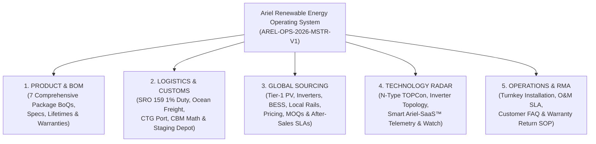
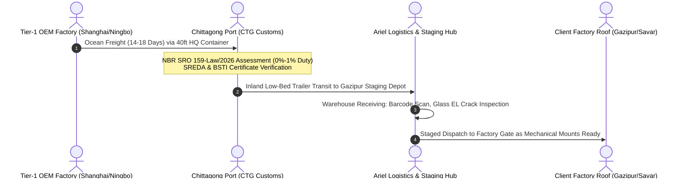
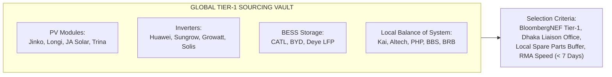
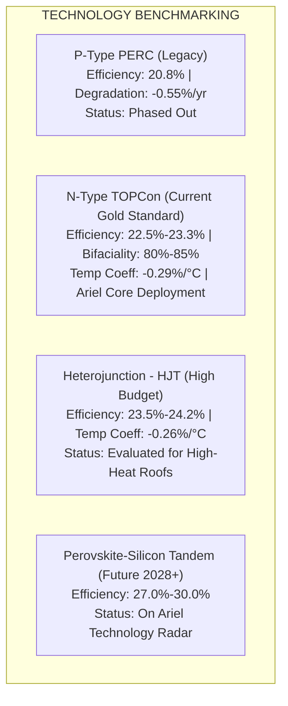
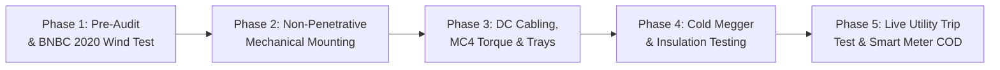
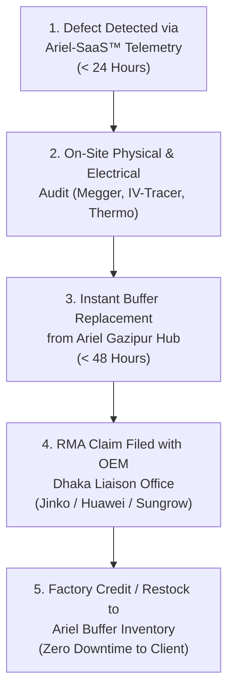

# Ariel Renewable Energy Limited: Master Operations, Sourcing & Logistics Blueprint
**Document Code**: `AREL-OPS-2026-MSTR-V1`  
**Classification**: Sovereign Corporate Operational Blueprint — Internal & Executive Master  
**Brand Compliance**: Strictly `ArielMC` / `Ariel Renewable Energy Limited`  
**Entity & Division**: Renewable Energy Division • ArielMC Enterprise Eco-System  
**Digital Command Hub**: `energy.arielmc.com` • `energy.arielmc.com/crm`  
**Effective Date**: November 2026  

---



---

## 1. Product: Comprehensive Bill of Materials (BOM) for Every Package

Ariel Renewable Energy delivers standardized, engineering-grade turnkey solar systems across **Factory (Industrial)**, **Commercial**, and **Household (Residential)** sectors. Every package uses Tier-1 components engineered to withstand Bangladesh's tropical maritime monsoon climate, high relative humidity (up to 95%), and BNBC 2020 basic wind speeds (150–260 km/h).

---

### Package Summary Matrix

| Code | Sector | Title | Capacity (DC) | Inverter AC | Est. Roof Area | Est. Monthly Yield | Amortized LCOE |
| :---: | :---: | :--- | :---: | :---: | :---: | :---: | :---: |
| **`F1`** | **Factory** | Industrial Base-Load Offset | **300 kWp** | 240 kW | 24,000 sq ft | 36,000–39,000 kWh | Tk 3.20/kWh |
| **`F2`** | **Factory** | Megawatt Flagship Net-Metering | **1,000 kWp (1 MWp)** | 880 kW | 78,000 sq ft | 125,000–135,000 kWh | Tk 3.10/kWh |
| **`F3`** | **Factory** | Net-Zero Multi-Roof Heavy Industrial | **2,500 kWp (2.5 MWp)** | 2,200 kW | 200,000 sq ft | 315,000–340,000 kWh | Tk 2.95/kWh |
| **`C1`** | **Commercial** | Corporate Office Tower Rooftop | **75 kWp** | 60 kW | 6,000 sq ft | 9,000–10,000 kWh | Tk 3.35/kWh |
| **`C2`** | **Commercial** | Retail Mall & Hospital Net-Metering | **200 kWp** | 160 kW | 16,000 sq ft | 25,000–27,000 kWh | Tk 3.20/kWh |
| **`H1`** | **Household** | Urban Villa Micro-Array (Grid-Tied) | **10 kWp** | 10 kW | 800 sq ft | 1,200–1,350 kWh | Tk 3.65/kWh |
| **`H2`** | **Household** | Sovereign Villa Hybrid BESS Micro-Array | **25 kWp + 30 kWh BESS** | 20 kW | 2,200 sq ft | 3,100–3,400 kWh | Tk 3.85/kWh |

---

### Detailed Itemized Bill of Materials (BoQ) by Package

#### 1. Package `F1`: Industrial Base-Load Offset (300 kWp)
- **Target Facility**: RMG Stitching units, light packaging sheds, pharmaceuticals, medium warehouses.
- **Interconnection**: 400V LT / 11kV HT Substation Net-Metering.

| Item No. | Component Description | Make / Engineering Model | BoQ Qty | Unit | Guarantee / Warranty | Expected Lifetime |
| :---: | :--- | :--- | :---: | :---: | :--- | :--- |
| **1.01** | **N-Type TOPCon Bifacial Dual-Glass PV Modules** (620Wp, 23.0% efficiency, 80% bifaciality) | Jinko Tiger Neo / Longi Hi-MO 7 (Tier-1) | 484 | Pcs | 15-Yr Workmanship / 30-Yr Linear (87.4% power) | 30+ Years |
| **1.02** | **C&I Three-Phase Grid-Tied String Inverter** (110 kW AC, 98.6% max efficiency, 10 MPPTs, AFCI built-in) | Sungrow SG110CX-P2 / Huawei SUN2000-100KTL-M2 | 2 | Units | 5-Yr Standard + 5-Yr Extended Factory Warranty | 20 Years |
| **1.03** | **C&I String Inverter** (40 kW AC, 4 MPPTs, for array balance) | Sungrow SG40CX / Huawei SUN2000-40KTL | 1 | Unit | 5-Yr Standard + 5-Yr Extended Factory Warranty | 20 Years |
| **1.04** | **Aluminum Mounting Structure & Clamping Profiles** (Anodized 6063-T6, 15–20 µm anodization, Trapezoidal seam clamps) | Kai Aluminum / Altech (Local Extrusion, Zero Duty) | 300 | kWp | 15-Yr Anti-Corrosion Structural Guarantee | 30+ Years |
| **1.05** | **Fasteners & Hardware** (SUS304 Stainless Steel bolts, serrated flange nuts, EPDM rubber gaskets) | Standard A2-70 / SUS304 | 2,800 | Sets | 25-Yr Corrosion-Free Guarantee | 30+ Years |
| **1.06** | **Solar DC Cable** (1×4mm² & 1×6mm² Tinned Copper, Cross-linked XLPO, 1500V DC rated, Halogen-Free) | KBE Solar / Lapp Group / BRB Solar | 4,200 | Mtr | 25-Yr Weather & UV Resistance Guarantee | 30+ Years |
| **1.07** | **Heavy-Duty AC Armored Cable** (3.5 Core 185mm² / 240mm² Copper XLPE, 0.6/1kV) | BBS Cables / BRB Cables (BSTI Certified) | 280 | Mtr | 10-Yr Manufacturer Warranty | 30 Years |
| **1.08** | **DC Combiner & Surge Protection Box** (IP66, Type II SPD 1500V, 16A DC fuses) | Schneider / Suntree / ZJBENY | 6 | Units | 5-Yr Replacement Warranty | 20 Years |
| **1.09** | **AC Distribution Panel (LT ACB/MCCB)** (630A 4-Pole Motorized MCCB with Microprocessor trip unit, Class I+II SPD) | ABB / Schneider Electric / Siemens | 1 | Set | 5-Yr Industrial Warranty | 25 Years |
| **1.10** | **Substation Net-Metering Protection Interface** (Neutral grounding resistor, directional earth fault relay, Class 0.2S meter) | Siemens / Schneider / Secure Meters | 1 | Lot | 5-Yr Warranty | 20 Years |
| **1.11** | **Lightning & Earthing System** (Chemical copper-bonded rods 20mm × 3m, 25×3mm copper tape, Earth resistance < 1.0 Ω) | Pure Copper / Erico ERITECH | 1 | Lot | 15-Yr System Guarantee | 30+ Years |
| **1.12** | **SCADA & Smart Weather Monitoring Station** (Pyranometer, ambient temp, cell temp, wind speed sensor, Ariel-SaaS™ IoT Box) | Ariel-SaaS™ Industrial IoT Gate | 1 | Set | 5-Yr Replacement & Cloud SLA | 15 Years |

---

#### 2. Package `F2`: Megawatt Flagship Net-Metering (1.0 MWp)
- **Target Facility**: Composite Knitwear complexes, Spinning Mills, Denim weaving, Ceramic tile factories.
- **Interconnection**: 11kV HT Substation via Dedicated 1,250 kVA Step-Up Transformer.

| Item No. | Component Description | Make / Engineering Model | BoQ Qty | Unit | Guarantee / Warranty | Expected Lifetime |
| :---: | :--- | :--- | :---: | :---: | :--- | :--- |
| **2.01** | **N-Type TOPCon Bifacial Dual-Glass PV Modules** (625Wp, 23.2% efficiency, 2.0+2.0mm heat-strengthened glass) | Jinko Tiger Neo / Longi Hi-MO 7 (Tier-1) | 1,600 | Pcs | 15-Yr Workmanship / 30-Yr Linear (87.4% power) | 30+ Years |
| **2.02** | **High-Power Utility-Grade C&I String Inverters** (125 kW AC, 12 MPPTs, Smart I-V curve diagnosis, IP66) | Sungrow SG125CX-P2 / Huawei SUN2000-115KTL-M2 | 7 | Units | 5-Yr Standard + 5-Yr Extended Factory Warranty | 20 Years |
| **2.03** | **Aluminum Mounting Structure & Clamping Profiles** (Anodized 6063-T6, PEB seam-clamps, Wind rated 220 km/h) | Kai Aluminum / Altech Local Extrusion | 1,000 | kWp | 15-Yr Anti-Corrosion Guarantee | 30+ Years |
| **2.04** | **Outdoor Stepped Solar Step-Up Transformer** (1,250 kVA, 0.400 / 11 kV, Dyn11, ONAN cooling, Copper wound) | Energypac / Siemens / Adex | 1 | Unit | 5-Yr Manufacturer Warranty | 30+ Years |
| **2.05** | **11kV HT Vacuum Circuit Breaker (VCB) Panel** (630A, 25kA/3s fault rating, IDMT overcurrent & earth fault relays) | Schneider Electric / ABB / Siemens | 1 | Panel | 5-Yr Comprehensive Warranty | 25 Years |
| **2.06** | **Solar DC Cable** (1×4mm² & 1×6mm² Tinned Copper XLPO, 1500V DC) | KBE Solar / Lapp Group | 14,500 | Mtr | 25-Yr Weather & UV Guarantee | 30+ Years |
| **2.07** | **11kV HT XLPE Armored Cable** (3-Core 120mm² Copper, screened) | BRB Cable Industries / BBS Cables | 350 | Mtr | 10-Yr Warranty | 30 Years |
| **2.08** | **Class 0.2S Bi-Directional Smart Net Meter & Dual-Ratio CT/PTs** (Utility approved for DESCO/DPDC/BREB) | Secure Meters / Schneider ION9000 | 1 | Set | 5-Yr Utility Approved Warranty | 20 Years |
| **2.09** | **Ariel-SaaS™ Cloud Telemetry & Automated Weather Station** (Class-A Secondary Standard Pyranometer, Drone Thermography link) | Ariel-SaaS™ Telemetry Hub | 1 | Set | 5-Yr Cloud SLA & Hardware Guarantee | 15 Years |

---

#### 3. Package `F3`: Net-Zero Multi-Roof Heavy Industrial (2.5 MWp)
- **Target Facility**: Giant textile spinning mills, steel rolling complexes, mega logistics hubs.
- **Interconnection**: 33kV Dedicated Express Feeder Substation with SCADA automation.

| Item No. | Component Description | Make / Engineering Model | BoQ Qty | Unit | Guarantee / Warranty | Expected Lifetime |
| :---: | :--- | :--- | :---: | :---: | :--- | :--- |
| **3.01** | **N-Type TOPCon Bifacial Dual-Glass PV Modules** (625Wp, 23.2% efficiency) | Jinko Solar / Longi / Trina Vertex N | 4,000 | Pcs | 15-Yr Workmanship / 30-Yr Linear (87.4%) | 30+ Years |
| **3.02** | **Utility-Scale String Inverters** (250 kW AC, 1500V DC, 12 MPPTs, IP66) | Sungrow SG250HX / Huawei SUN2000-215KTL-H0 | 9 | Units | 5-Yr Standard + 5-Yr Extended Warranty | 20 Years |
| **3.03** | **Central Solar Step-Up Substation Unit** (3,000 kVA, 0.800 / 33 kV, Compact Skid-Mounted Kiosk) | ABB / Siemens / Energypac | 1 | Station | 5-Yr Industrial Warranty | 30 Years |
| **3.04** | **33kV Outdoor Switchyard Equipment** (33kV VCB, Disconnectors, Lightning Arresters, 33kV CT/PTs) | Siemens / ABB | 1 | Lot | 5-Yr Engineering Warranty | 30 Years |
| **3.05** | **6063-T6 HDG Mounting Truss & Clamps** (Tailored for complex multi-shed layouts) | Kai Aluminum / PHP Steel | 2,500 | kWp | 15-Yr Structural Warranty | 30+ Years |
| **3.06** | **SCADA & Fiber-Optic Ring Network** (IEC 60870-5-104 & Modbus TCP telemetry to National Load Dispatch Centre [NLDC]) | Ariel-SaaS™ Enterprise SCADA | 1 | System | 5-Yr Maintenance & Software SLA | 20 Years |

---

#### 4. Package `C1`: Corporate Office Tower Rooftop (75 kWp)
- **Target Facility**: Corporate headquarters in Gulshan/Banani/Motijheel, IT parks, commercial bank branches.
- **Interconnection**: 400V LT Grid Synchronized.

| Item No. | Component Description | Make / Engineering Model | BoQ Qty | Unit | Guarantee / Warranty | Expected Lifetime |
| :---: | :--- | :--- | :---: | :---: | :--- | :--- |
| **4.01** | **All-Black / Dual-Glass N-Type TOPCon Panels** (580Wp, High Aesthetic Commercial Grade) | Jinko Tiger Neo All-Black / Longi | 130 | Pcs | 15-Yr Workmanship / 30-Yr Linear | 30 Years |
| **4.02** | **C&I String Inverter** (60 kW AC, 6 MPPTs, Ultra-quiet fanless cooling) | Huawei SUN2000-60KTL-M0 / Sungrow SG60CX | 1 | Unit | 5-Yr Standard + 5-Yr Extended Warranty | 20 Years |
| **4.03** | **Non-Penetrative Ballasted Concrete Mounting System** (Aerodynamic wind-deflecting aluminum pods, zero roof puncture) | Aerocompact / Local Cast Ballast Racks | 75 | kWp | 15-Yr Warranty | 30 Years |
| **4.04** | **Low-Voltage AC Combiner & Panel** (125A MCCB with Type I+II SPD) | Schneider Electric | 1 | Unit | 5-Yr Warranty | 25 Years |
| **4.05** | **Smart Net Meter (Class 0.5S)** | Secure Meters / DPDC Approved | 1 | Unit | 5-Yr Warranty | 20 Years |

---

#### 5. Package `C2`: Retail Mall & Hospital Net-Metering (200 kWp)
- **Target Facility**: Shopping complexes, diagnostic centers, tertiary private hospitals.
- **Interconnection**: 400V LT / 11kV Substation.

| Item No. | Component Description | Make / Engineering Model | BoQ Qty | Unit | Guarantee / Warranty | Expected Lifetime |
| :---: | :--- | :--- | :---: | :---: | :--- | :--- |
| **5.01** | **N-Type TOPCon Bifacial Dual-Glass PV Modules** (620Wp) | Jinko Tiger Neo / JA Solar DeepBlue 4.0 Pro | 324 | Pcs | 15-Yr Workmanship / 30-Yr Linear | 30 Years |
| **5.02** | **C&I Inverters** (100 kW AC × 1 + 60 kW AC × 1) | Sungrow SG100CX / Huawei SUN2000-100KTL | 2 | Units | 5-Yr Standard + 5-Yr Extended Warranty | 20 Years |
| **5.03** | **Ballasted & Elevated Aluminum Canopies** (Allows rooftop walking & maintenance access) | Kai Aluminum 6063-T6 Custom Elevated Truss | 200 | kWp | 15-Yr Anti-Corrosion Warranty | 30 Years |
| **5.04** | **Fast-Acting Rapid Shutdown & Arc-Fault Interrupters (AFCI)** (NFPA 70 hospital safety compliance) | Integrated in Huawei / Tigo TS4 | 1 | Lot | 5-Yr Safety Clearance | 20 Years |

---

#### 6. Package `H1`: Urban Villa Micro-Array (10 kWp Grid-Tied)
- **Target Facility**: Residential duplexes, Gulshan/Banani/Baridhara private villas.
- **Interconnection**: 230V Single-Phase / 400V Three-Phase LT Net-Metering.

| Item No. | Component Description | Make / Engineering Model | BoQ Qty | Unit | Guarantee / Warranty | Expected Lifetime |
| :---: | :--- | :--- | :---: | :---: | :--- | :--- |
| **6.01** | **High-Efficiency Mono PERC / N-Type TOPCon Panels** (580Wp) | Jinko Solar / Longi Solar | 18 | Pcs | 12-Yr Product / 25-Yr Performance | 25+ Years |
| **6.02** | **Three-Phase Residential Smart String Inverter** (10 kW AC, 2 MPPTs, Built-in WiFi/App) | Growatt MOD 10KTL3-X / Huawei SUN2000-10KTL-M1 | 1 | Unit | 5-Yr Full Replacement Warranty | 15–20 Years |
| **6.03** | **Elevated Rooftop Aluminum Frame** (Preserves garden / walking space on roof terrace) | Local Kai 6063-T6 Extrusion | 10 | kWp | 10-Yr Structural Guarantee | 25 Years |
| **6.04** | **Residential AC/DC Isolator & SPD Box** | Suntree / ABB | 1 | Unit | 3-Yr Warranty | 15 Years |
| **6.05** | **Net-Metering Smart Bi-Directional Meter** (DESCO/DPDC programmed) | Secure Sprint / Hexing | 1 | Unit | 5-Yr Utility Warranty | 15 Years |

---

#### 7. Package `H2`: Sovereign Villa Hybrid BESS Micro-Array (25 kWp + 30 kWh BESS)
- **Target Facility**: Luxury estates, diplomat residences, continuous zero-blackout executive villas.
- **Interconnection**: 400V LT Hybrid Net-Metering with 10ms UPS Backup.

| Item No. | Component Description | Make / Engineering Model | BoQ Qty | Unit | Guarantee / Warranty | Expected Lifetime |
| :---: | :--- | :--- | :---: | :---: | :--- | :--- |
| **7.01** | **Premium N-Type TOPCon Solar Modules** (580Wp, All-Black Aesthetic) | Jinko Tiger Neo All-Black / Canadian Solar | 44 | Pcs | 15-Yr Product / 30-Yr Linear Performance | 30 Years |
| **7.02** | **Three-Phase Hybrid Energy Storage Inverter** (20 kW AC, Dual MPPT, 10ms seamless transfer switch) | Deye SUN-20K-SG01HP3 / Huawei LUNA Hybrid | 1 | Unit | 5-Yr Standard + 5-Yr Extended Warranty | 15–20 Years |
| **7.03** | **LiFePO4 Lithium Iron Phosphate Battery Energy Storage System (BESS)** (30 kWh Useful Capacity, High Voltage, 1C discharge) | CATL / BYD Battery-Box / Deye High-Voltage LFP | 1 | Rack (6 modules) | 10-Yr Warranty / 6,000 Cycles @ 80% DoD | 15 Years |
| **7.04** | **Smart Energy Meter with CTs & Zero-Export Control** | Eastron / Deye Meter | 1 | Unit | 5-Yr Warranty | 15 Years |
| **7.05** | **Elevated Gazebo Pergola Aluminum Structure** (Dual-purpose: waterproof solar roof + shaded terrace lounge) | Architectural Kai 6063-T6 Powder-Coated Truss | 25 | kWp | 15-Yr Structural Warranty | 30 Years |

---

## 2. Logistics: Importation, Shipping, Customs & Staging Blueprint



### 1. Customs Duty Structure (NBR SRO No. 159-Law/2026/14/Customs)

Under the landmark SRO 159, import duties on core renewable hardware have been reduced to near-zero, saving approximately **16% of total turnkey project CapEx**:

| Hardware Classification | Bangladesh H.S. Code | Statutory Customs Duty | Total Tax Incidence (CD+RD+SD+VAT+AIT+AT) | Mandatory Clearing Pre-Requisite |
| :--- | :---: | :---: | :---: | :--- |
| **Assembled Solar PV Modules** | **`8541.43.00`** | **0.0%** | **0.0% – 1.0%** | Must attach SREDA Online Certification & OEM IEC 61215/61730 certificates. |
| **Unassembled Photovoltaic Cells** | **`8541.42.00`** | **0.0%** | **0.0%** | Complete duty exemption for local assemblers. |
| **Solar PV Inverters (String/Central)** | **`8504.40.90`** | **0.0%** | **1.0%** (AIT Only) | LC and Commercial Invoice must explicitly declare: *"Solar Photovoltaic Inverter for Renewable Power"* with SREDA clearance. |
| **LiFePO4 Lithium Solar Battery Storage** | **`8507.60.00`** | **0.0%** | **1.0%** | Must explicitly state *"Lithium-Ion Energy Storage for Solar BESS"* (prevents customs assessing 37% automotive/UPS duty). |
| **Imported Aluminum Rails & Struts** | **`7610.90.00`** | **25.0%** | **58.6%** | **STRICT RULE: NEVER IMPORT.** Source 100% locally from Kai/Altech/PHP to eliminate this 58.6% tax trap. |

### 2. Client ERQ USD Account Mechanism ($0 LC Exposure for Ariel)
- For export-oriented clients (RMG, textiles, leather), utilize their **Export Retention Quota (ERQ) USD account**.
- The client opens the foreign import LC directly from their factory's dollar reserves.
- **Triple Benefit**:
  1. The client saves a 2%–3% currency conversion margin.
  2. Eliminates 100% of Ariel's working capital requirement for hardware imports.
  3. Insulates the project completely from BDT/USD foreign exchange volatility.

### 3. Container Loading & CBM Math (40ft High Cube Container)

| Equipment | Packing Configuration | Units per 40ft HQ | Total Capacity per Container | Container Gross Weight |
| :--- | :--- | :---: | :---: | :---: |
| **620W N-Type TOPCon Modules** | 36 panels/pallet × 26 vertical pallets | **936 Panels** | **580.32 kWp** | ~24,500 kg (Safe road limit) |
| **580W Residential Panels** | 36 panels/pallet × 26 vertical pallets | **936 Panels** | **542.88 kWp** | ~23,800 kg |
| **110 kW String Inverters** | 2 units/wooden crate × 32 crates | **64 Inverters** | **7.04 MW AC Capacity** | ~6,800 kg |
| **LiFePO4 5 kWh Battery Modules** | Individual shockproof crates | **180 Units** | **900 kWh BESS** | ~9,200 kg |

### 4. Port of Discharge & Inland Routing
- **Primary Ocean Route**: Port of Departure (Shanghai / Ningbo / Shenzhen) ➔ **Chattogram Port (CTG)**. Typical ocean transit: **14 to 18 days**.
- **Alternative Congestion Bypass**: Discharge at CTG, transfer via bonded container feeder barge directly to **Pangaon Inland Container Depot (PICD)** in Keraniganj, Dhaka. Bypasses Dhaka-Chattogram highway weighbridges and port congestion.
- **Central Staging Warehouse**:
  - Located in **Gazipur Industrial Belt (near Konabari / Joydebpur intersection)**.
  - 12,000 sq ft covered staging floor with heavy-duty pallet racking and a 5-ton overhead gantry crane.
  - Serves as the buffer hub to stage module deliveries to client factories strictly in sync with mechanical roof-mounting progress (prevents panels sitting exposed on factory grounds).

---

## 3. Sourcing: Worldwide Tier-1 OEM Sourcing Matrix



### 1. PV Module Tier-1 Comparison Matrix

| Manufacturer | Flagship Series | Cell Architecture | Max Efficiency | Temp. Coeff. ($P_{max}$) | Dhaka/CTG Office Presence | Standard Wholesale Benchmark |
| :--- | :--- | :--- | :---: | :---: | :--- | :---: |
| **Jinko Solar** *(Preferred)* | **Tiger Neo N-Type 72HL4-BDV** (610–630W) | 16BB N-Type TOPCon | **23.23%** | **-0.29%/°C** | Direct Liaison Office in Gulshan-1, Dhaka; bonded warehouse support. | **$0.092 – $0.102 / Wp** |
| **Longi Solar** | **Hi-MO 7** (600–625W) | HPDC Dual-Glass N-Type | **23.10%** | **-0.28%/°C** | Active Bangladesh Country Manager & Tier-1 distribution partners. | **$0.093 – $0.104 / Wp** |
| **JA Solar** | **DeepBlue 4.0 Pro** (615–635W) | Bycium+ N-Type TOPCon | **23.00%** | **-0.30%/°C** | Local technical sales representation in Dhaka. | **$0.089 – $0.099 / Wp** |
| **Trina Solar** | **Vertex N** (610–625W) | 210mm Rectangular TOPCon | **23.10%** | **-0.30%/°C** | Regional South Asia service center. | **$0.091 – $0.101 / Wp** |
| **Canadian Solar** | **TOPHiKu7** (615–630W) | N-Type TOPCon Bifacial | **22.80%** | **-0.30%/°C** | Distributor network representation. | **$0.092 – $0.103 / Wp** |

### 2. Inverter Manufacturer Comparison Matrix

| Manufacturer | Flagship C&I Models | Topology & MPPTs | Max Efficiency | Local Technical RMA Center | Pricing Benchmark |
| :--- | :--- | :--- | :---: | :--- | :---: |
| **Huawei FusionSolar** *(Preferred)* | **SUN2000-100KTL-M2** / **115KTL-M2** | Decentralized Multi-MPPT (10 MPPTs), AFCI built-in, no fuses | **98.8%** | Huawei Technologies Bangladesh (Gulshan-2, Dhaka); 48-hr swap RMA. | **$0.038 – $0.045 / W** |
| **Sungrow Power** *(Preferred)* | **SG110CX-P2** / **SG125CX-P2** | Multi-MPPT (12 MPPTs), 30A string current, IP66 / C5 anti-corrosion | **98.6%** | Sungrow Bangladesh Service Hub (Uttara, Dhaka); certified local engineers. | **$0.035 – $0.042 / W** |
| **Growatt** | **MAX 100-125KTL3-X LV** | 10 MPPTs, Type II DC/AC SPD | **98.5%** | Authorized service agency in Tejgaon, Dhaka. | **$0.032 – $0.038 / W** |
| **Solis (Ginlong)** | **Solis-110K-5G-PRO** | 8 MPPTs, 1500V DC | **98.5%** | Authorized distributor support in Dhaka. | **$0.033 – $0.039 / W** |

### 3. Battery Energy Storage System (BESS) Matrix

| Manufacturer | Chemistry & Model | Scalability | Cycle Life @ 80% DoD | Round-Trip Efficiency | Pricing Benchmark |
| :--- | :--- | :--- | :---: | :---: | :---: |
| **CATL** | Liquid-Cooled EnerOne / EnerX LFP | Utility containerized (1.5–3.0 MWh) | **8,000+ Cycles** | **94.5%** | **$125 – $145 / kWh** |
| **BYD Energy** | Battery-Box Commercial LFP | Rack-mounted (50 kWh to 1 MWh) | **6,000+ Cycles** | **93.5%** | **$135 – $155 / kWh** |
| **Deye Energy** | High-Voltage BOS-G LiFePO4 Rack | Modular C&I (20 kWh to 300 kWh) | **6,000 Cycles** | **92.5%** | **$130 – $150 / kWh** |
| **Huawei LUNA2000** | Smart String ESS (200 kWh) | Modular string-level optimization | **6,000 Cycles** | **94.0%** | **$160 – $185 / kWh** |

### 4. Local Balance of System (BoS) Partners (Bangladesh Sourcing)
- **Mounting Rails & Mid/End Clamps**: **Kai Aluminum Industries Ltd** and **Altech Aluminum** (6063-T6 aluminum extrusion with 15–20 micron clear anodization).
- **HDG Steel Purlins & Elevated Trusses**: **PHP Steels Ltd** and **BSRM** (minimum 85 micron hot-dip galvanization per ASTM A123).
- **AC Armored Cables & Substation Conductors**: **BRB Cable Industries Ltd** and **BBS Cables Ltd** (BSTI approved 99.99% pure annealed electrolytic copper).
- **Substation Transformers & HT Switchgear**: **Energypac Engineering Ltd** and **Adex Corporation**.

---

## 4. Technology: Efficiency Optimization & Continuous Intelligence Pipeline



### 1. Why N-Type TOPCon is the Optimal Choice for Bangladesh
1. **Low Temperature Coefficient ($-0.29\%/^\circ\text{C}$ vs $-0.35\%/^\circ\text{C}$ for PERC)**: In Bangladesh, summer factory metal roof temperatures routinely reach $65^\circ\text{C}$ to $72^\circ\text{C}$. TOPCon loses significantly less power under extreme heat, delivering **3.5% to 5.0% higher real-world annual kilowatt-hour yield**.
2. **Superior Bifaciality (80%–85%)**: Generates power from reflected light off white-painted PEB roofs or light concrete slabs, providing a **6% to 12% additional albedo generation boost**.
3. **Zero Light-Induced Degradation (LID)**: Boron-oxygen pairs common in older P-Type cells do not occur in N-Type silicon, reducing Year-1 degradation to $\le 1.0\%$ (compared to 2.5% for PERC).

### 2. Ariel Renewable Energy "Technology Radar" Pipeline
To ensure Ariel maintains an enduring technological advantage and keeps customers updated on breakthrough innovations, the following automated intelligence monitoring pipeline is instituted:

```
[QUARTERLY INTELLIGENCE AUDIT]
• BNEF (BloombergNEF) Tier-1 PV Module Maker List Review (Quarterly)
• PV Tech / Infolink Cell & Wafer Spot Price Tracker (Weekly)
• SREDA & Power Division Policy Tracking (Monthly)
• Intersolar Europe (Munich) & SNEC (Shanghai) Tech Scouting (Annual)
• Ariel-SaaS™ Telemetry AI Benchmarking (Continuous Real-Time Analytics)
```

- **Ariel-SaaS™ SCADA Telemetry**: Cloud-connected pyranometers and string monitors sample voltage, current, and solar irradiance every 60 seconds.
- **Smart I-V Curve Diagnostic**: Scans all strings across 1.0 MWp arrays in under 15 minutes, automatically identifying micro-cracks, diode failures, PID (potential induced degradation), or localized shading without manual rooftop climbing.

---

## 5. Operations: Installation, O&M, FAQ & Warranty RMA SOP



---

### 1. Step-by-Step Turnkey Installation SOP

#### Phase 1: Structural Audit & Engineering Sign-Off
- Physical inspection of Pre-Engineered Building (PEB) rafters and purlins by an **IEB-registered structural engineer**.
- Calculate combined dead load ($16\text{ kg/m}^2$) + live maintenance load ($20\text{ kg/m}^2$) + wind uplift (BNBC 2020 velocity: Gazipur/Dhaka $180\text{ km/h}$, Chattogram $260\text{ km/h}$).
- Torque-pull test on purlin clamps to certify $\ge 3.5\text{ kN}$ slip resistance.

#### Phase 2: Non-Penetrative Mechanical Mounting
- **Standing-Seam Metal Roofs**: Use aluminum standing-seam clamps with EPDM gaskets tightened to **14 N·m torque**. **Zero roof perforations.**
- **Corrugated Tin Roofs**: Fasten to structural steel purlins using bi-metal self-drilling screws with bonded EPDM washers, sealed with UV-resistant silicone sealant.
- **Concrete RCC Roofs**: Aerodynamic ballasted aluminum frames angled at **$10^\circ$ to $12^\circ$ South tilt** with pre-cast concrete ballast blocks (no slab puncturing, preserving roof water-proofing).

#### Phase 3: DC Cabling & Fire Safety Lanes
- Maintain a **1.2-meter continuous perimeter fire pathway** around all panel blocks per Fire Service & Civil Defence (FSCD) and RMG Sustainability Council (RSC) standards.
- Run all DC cabling in hot-dip galvanized (HDG) perforated cable trays with snap-on covers.
- Use calibrated torque wrenches on all MC4 connectors (**2.5 to 3.0 N·m**) to prevent hot-spot arc faults.

#### Phase 4: Cold Electrical Commissioning
- Measure open-circuit voltage ($V_{oc}$) and short-circuit current ($I_{sc}$) on every string; record in commissioning logs.
- Perform high-voltage insulation resistance testing (Megger Test at 1,000V DC): must achieve $\ge 50\text{ M}\Omega$ phase-to-earth.
- Earth pit resistance verification: total station earth resistance must measure **$< 1.0\,\Omega$**.

#### Phase 5: Hot Commissioning, Anti-Islanding Trip Test & COD
- Utility technical committee (DESCO/DPDC/BREB/BPDB) attends site for live synchronization.
- **Mandatory Anti-Islanding Trip Test**: Utility pulls the 11kV grid feeder breaker while solar plant is operating at full daytime power. The inverters must automatically decouple and shut down in **$< 0.5$ seconds**.
- Install and seal the bi-directional Class 0.2S smart meter with dual CTs/PTs. Sign commercial operation date (COD) protocol.

---

### 2. After-Sales Support & Operation & Maintenance (O&M) SLA

| Maintenance Tier | Execution Frequency | Activities Performed |
| :--- | :---: | :--- |
| **Preventative Cleaning** | Bi-Weekly / Monthly | Washing panels with demineralized water ($< 50\text{ ppm TDS}$) during low-sun hours ($< 8:00\text{ AM}$) using soft microfiber brushes. |
| **Thermographic Inspection** | Semi-Annually | RTK drone thermal infrared imaging scan to identify sub-surface cell micro-cracks, hot spots, or bypass diode failures. |
| **Electrical Re-Torque** | Bi-Annually | Calibration and re-torquing of all AC/DC terminal connections, busbars, and inverter terminals to manufacturer specifications. |
| **Vegetation & Drainage** | Monthly | Clearing gutter channels, checking roof rainwater outlets, and trimming surrounding tree branches. |
| **Continuous Telemetry** | 24/7/365 | Ariel-SaaS™ automated monitoring tracking daily Performance Ratio (PR), inverter yield discrepancies, and grid outages. |

- **Guaranteed Availability SLA**: **99.0% plant availability** during daylight hours.
- **Mean Time to Respond (MTTR)**:
  - Critical Fault (Total plant outage): **Under 4 hours on-site in Dhaka/Gazipur/Savar**; under 8 hours in Chattogram.
  - Minor Fault (Single string down): **Under 24 hours**.

---

### 3. Customer Frequently Asked Questions (FAQ)

#### Q1: Will installing solar damage my factory roof or cause rainwater leaks?
> **Answer**: No. On modern standing-seam roofs, we use patented non-penetrative aluminum clamps that grab the standing seam without penetrating the metal sheet. On corrugated roofs, all penetrations go directly into heavy structural purlins using specialized bi-metal screws with vulcanized EPDM seals, backed by Ariel's **5-Year Zero-Leak Roof Warranty**.

#### Q2: What happens if a severe cyclone hits Bangladesh?
> **Answer**: All mounting structures and clamps are engineered according to the **Bangladesh National Building Code (BNBC 2020)** wind zone maps. Our structures in Gazipur and Savar withstand basic wind speeds of $180\text{ km/h}$, while systems in Chattogram and coastal economic zones are reinforced to withstand $260\text{ km/h}$ gale-force winds.

#### Q3: How do we receive money for surplus power exported on Fridays and holidays?
> **Answer**: Under the Power Division’s Net-Metering Guidelines, the bi-directional meter records all units exported to the national grid. For battery-integrated systems commissioned before **February 28, 2027**, excess electricity is purchased at a guaranteed **Tk 10.50 per unit (kWh)** and credited directly into your commercial bank account on a quarterly settlement cycle.

#### Q4: What is the degradation rate of the solar panels over time?
> **Answer**: Our Tier-1 N-Type TOPCon panels feature a guaranteed maximum Year-1 degradation of $\le 1.0\%$, and an annual linear degradation of $\le 0.40\%$ from Years 2 to 30. By Year 30, the panels are guaranteed to produce at least **87.4% of their original rated power**.

#### Q5: Can the solar plant run my factory during complete national grid blackouts?
> **Answer**: Standard grid-tied systems shut down during a grid failure to protect utility linesmen (anti-islanding). However, with our **Hybrid BESS packages** or our smart **PV-Diesel Generator Controller**, solar automatically synchronizes with your on-site gas/diesel generator or battery bank, displacing up to 60% of expensive generator fuel without backfeeding.

---

### 4. Standard Operating Procedure on Return & Warranty Service (RMA SOP)



#### Step 1: Rapid Defect Detection & Logging
- Ariel-SaaS™ monitors string-level yield. An alert triggers if any string deviates by $> 10\%$ from adjacent strings under identical solar irradiance.
- Service ticket generated in Master-CRM within 60 minutes.

#### Step 2: On-Site Diagnostic Audit
- Ariel field engineer dispatches with calibrated multimeter, IV curve tracer, and FLIR thermal camera.
- Tests conducted:
  - Voltage across terminals ($V_{oc}$).
  - EL (Electroluminescence) camera imaging to detect micro-cracks.
  - Inverter error log extraction via RS485/Bluetooth interface.

#### Step 3: Zero-Downtime Buffer Replacement
- To prevent customer revenue loss while warranty claims are processed with overseas factories, Ariel maintains a **2% Spare Module Buffer and 1 Spare Inverter of each primary rating** at our central Gazipur Staging Depot.
- The defective module or inverter is replaced with a brand-new unit from buffer stock within **48 hours**, restoring 100% plant generation immediately.

#### Step 4: OEM Warranty Claim Filing
- Ariel files the formal RMA claim with the OEM’s local Bangladesh office (e.g., Huawei Technologies Bangladesh Ltd in Gulshan, or Jinko Solar Dhaka office).
- Documentation submitted:
  1. High-resolution photos of defect and intact serial number barcode.
  2. Recorded IV-curve test results and thermal imagery.
  3. Original commercial invoice and shipping bill of entry under SRO 159.
- OEM inspects and issues formal credit note or replacement hardware, which restocks the Ariel Gazipur Buffer Inventory.

---

## 6. Executive Approval & Verification

**Approved By**:  
**Syed Akramul Hassan**  
Managing Director & CEO, Ariel Renewable Energy Limited  
*A Member of the ArielMC Enterprise Eco-System*  

**Headquarters**: House 30, Road 07, Block C, Niketon, Gulshan-1, Dhaka-1212  
**Command Portals**: `energy.arielmc.com` • `energy.arielmc.com/crm` • `erp.arielmc.com`  

