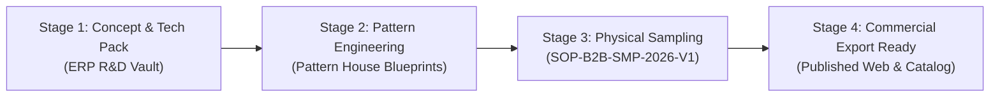

# ArielMC Enterprise R&D Incubation Framework & Model Portfolio
**Document Code**: `SOP-B2B-RND-2026-V1`  
**Classification**: Proprietary & Confidential — Sourcing & Design Vault  
**Brand Compliance**: Strictly `ArielMC` (Zero factory names, zero third-party disclosures)  
**Effective Date**: November 2026  

---

## 1. Executive Summary & Objective
This Standard Operating Procedure establishes the governance, technical incubation, asset management, and commercial gatekeeping for all prospective research and development (R&D) styles, prototype samples, and engineering patterns introduced into the ArielMC Enterprise Hub.

The objective is twofold:
1. **Protect Brand Equity & Intellectual Property**: Prevent premature public exposure of uncosted models or supplier-identifying engineering patterns.
2. **Accelerate Time-to-Market**: Provide a structured 4-stage pipeline that transitions design concepts into production-ready export models with locked BOMs, pre-negotiated factory MoUs, and verified FOB pricing.

---

## 2. The 4-Stage Gate R&D Lifecycle

### Stage 1: Design Vault Archival (`CONCEPT_LAB`)
- **Location**: `shared-assets/rnd-lab/{division}/{sku}/`
- **Visibility**: 100% Private (Internal ERP Sourcing Vault only).
- **Deliverables**: Lookbooks, high-resolution lifestyle photography, colorway studies, and material declarations.

### Stage 2: Pattern & BOM Engineering (`TECH_PACK_BOM`)
- **Location**: `shared-assets/rnd-lab/patterns/the-pattern-house-blueprints/`
- **Technical Specs**: Pattern cutting blueprints, exact centimeter/inch cutting layouts, seam allowance calculations, hardware BOM specifications.

### Stage 3: Factory Sampling & Costing (`PROTOTYPE_SAMPLING`)
- **Process**: Sourcing partner allocates master craftsman for physical prototype execution.
- **Yield Testing**: Square footage yield calculation for leather; yarn weight and crochet tension validation for fiber.
- **Financial Model**: CM (Cost of Making) + Raw Material BOM + 15% Inland Logistics + 10% Overhead = Factory Purchase Cost.

### Stage 4: Commercial Export Graduation (`COMMERCIAL_EXPORT`)
- **Publication**: Migrates from `rnd-lab` to production SKU in `shared-assets/products/{compendium-slug}/{department-slug}/{sku}/`.
- **Visibility**: Published live across Website (`www.arielmc.com`) and Catalog (`catalog.arielmc.com`).

---

## 3. R&D Incubated Model Compendium

### Division 01: The Leather Compendium

#### `RND-LD-01` — The Sovereign Grained Calfskin Structured Carryall
- **Category**: Structured Carry & Bags
- **Material**: Full-grain milled calfskin leather, gold-tone brass turnkey lock, suede microfiber interior.
- **Colorways**: Cognac Tan, Forest Emerald Green, Oyster Taupe.
- **Key Features**: Accordion structured interior, detachable leather shoulder strap, leather clochette with brass key.
- **Asset Vault**: `shared-assets/rnd-lab/01-leather/RND-LD-01-pebbled-leather-carryall/`

#### `RND-LD-02` — The Executive Foldover Flap Wine Calfskin Doctor Satchel
- **Category**: Structured Carry & Bags
- **Material**: Heavy-gauge pebbled full-grain leather in rich Bordeaux Wine with brushed gold hardware.
- **Key Features**: Curved foldover security flap with continuous full-zip closure, extended flapped wings with gold studs, exterior quick-access vertical phone slit pocket with curved drop pull, luxury interior with laptop partition and dedicated pen loops.
- **Asset Vault**: `shared-assets/rnd-lab/01-leather/RND-LD-02-executive-doctor-satchel/`

#### `RND-LD-03` — The Origami Winged Trapezoid Bordeaux Artisan Shopper
- **Category**: Handcrafted Leather Bags
- **Material**: Supple Bordeaux pebbled leather, solid brass protective feet.
- **Key Features**: Sculptural geometric origami silhouette with angled side gussets that fold inward via concealed magnetic fasteners, gently arched top rim, long tubular rolled shoulder straps, four brass base studs.
- **Asset Vault**: `shared-assets/rnd-lab/01-leather/RND-LD-03-origami-trapezoid-tote/`

#### `RND-LD-04` — The Dual-Handle Sovereign Executive Carryall Tote
- **Category**: Handcrafted Leather Bags
- **Material**: Architectural pebbled calfskin in Bordeaux Wine & Slate Charcoal Grey.
- **Key Features**: Dual-handle system (short hand-carry grab loops + elongated shoulder straps), interior top-zip chamber with magnetic retention tab, leather key leash with brass stud, multi-divider tech organizer for 15" laptop.
- **Asset Vault**: `shared-assets/rnd-lab/01-leather/RND-LD-04-dual-handle-executive-carryall/`

---

### Division 02: The Golden Fiber Edit

#### `RND-JD-01` — The Sovereign Dual-Tone Jute Vertical City Messenger
- **Category**: Everyday Carry & Bags
- **Material**: High-density natural golden jute canvas with sunset orange dyed panels, webbed shoulder strap.
- **Key Features**: Vertical document profile, front zipper security compartment, top velcro flap closure.
- **Asset Vault**: `shared-assets/rnd-lab/02-jute/RND-JD-01-dual-tone-vertical-messenger/`

#### `RND-JD-02` — The Bengal Indigo Braided Vanity & Linen Storage Duo
- **Category**: Modern Living & Décor
- **Material**: Heavy-gauge recycled cotton-jute braided cord in Deep Indigo Navy & Bleached Ecru.
- **Key Features**: 2-piece nesting basket set (Master: 34×22×18 cm, Petite: 26×18×14 cm), scalloped contrast whipstitch rim, integrated braided carry handles.
- **Asset Vault**: `shared-assets/rnd-lab/02-jute/RND-JD-02-indigo-braided-vanity-duo/`

#### `RND-JD-03` — The Bengal Flora Lidded Botanical Canister Trio
- **Category**: Modern Living & Décor
- **Material**: Artisanal crochet cord with natural ecru base, forest green edge trim, and terracotta floral motifs.
- **Key Features**: 3-piece nesting cylindrical storage canisters with snug-fitting lids and vertical loop finials, handcrafted sunflower daisy embroidery.
- **Asset Vault**: `shared-assets/rnd-lab/02-jute/RND-JD-03-flora-lidded-canister-trio/`

---

## 4. Technical Blueprint Archive (The Pattern House)

All engineering blueprints from *The Pattern House* are archived in high-resolution:
- `IMG_0558.jpg`: Travel Bag Master Blueprint (Body 40×28 cm, Side 28×22 cm, Front Pocket)
- `IMG_0559.jpg`: Tote & Pocket Blueprint (Body 16"×14", Pocket 9"×7", Base 12"×5", Straps 24"×1.5")
- `IMG_0560.jpg`: Gusset & Bag construction (40×36 cm)
- `IMG_0561.jpg`: Finished Tote pattern with seam allowance & stitch callouts
- `IMG_0562.jpg`: Exterior & Back pocket assembly specifications (24×24 cm)
- **Vault Location**: `shared-assets/rnd-lab/patterns/the-pattern-house-blueprints/`

